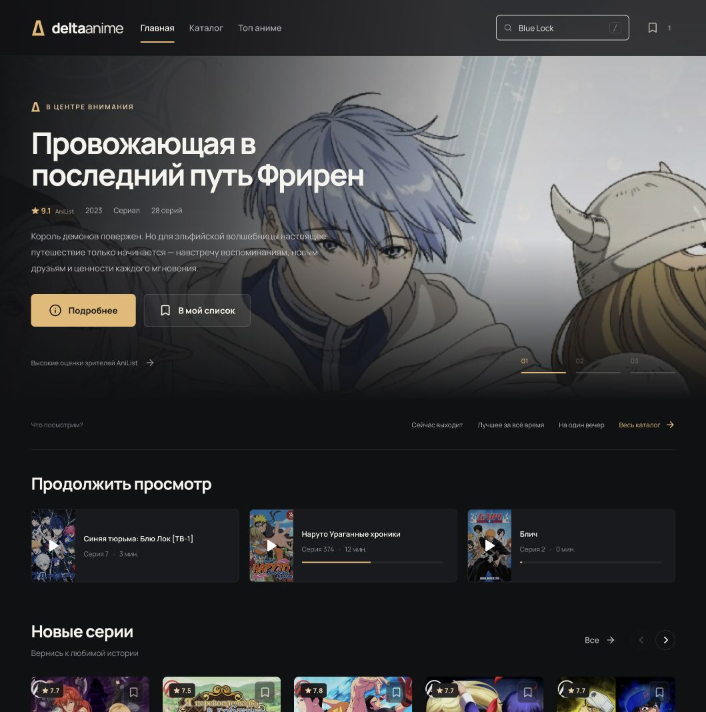
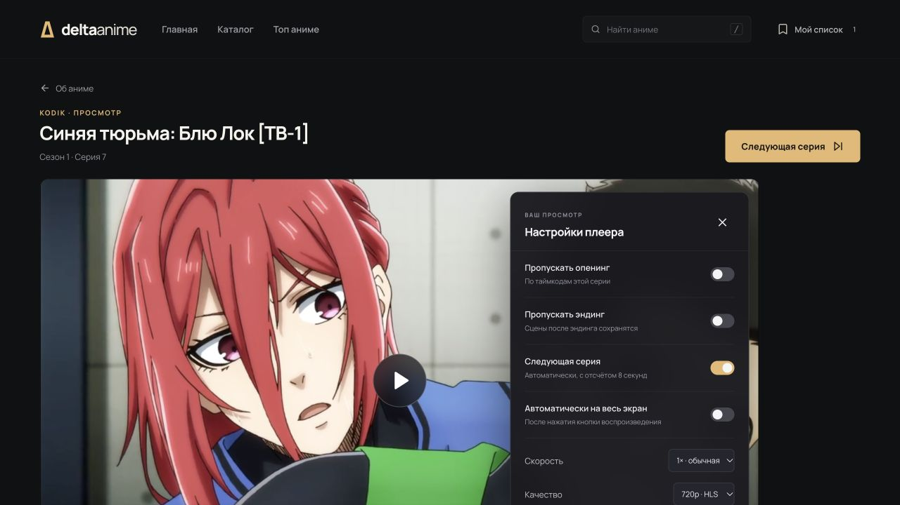

# DeltaAnime

[](https://github.com/bekjonbegmatov/DeltaAnime/actions/workflows/ci.yml)

Аниме-каталог с общим поиском по источникам, выбором озвучки и отдельной страницей просмотра. React-интерфейс и Python API собираются в один Docker-образ; для запуска нужен только Docker Compose.

[Быстрый запуск](#быстрый-запуск) · [Возможности](#возможности) · [Источники](#источники) · [Разработка](#разработка) · [Проверки](#проверки)



<details>
<summary>Плеер и мобильная версия</summary>



[Главная на телефоне](docs/cinema-home-mobile.jpg) · [Настройки плеера на телефоне](docs/cinema-player-mobile.jpg) · [Поиск на телефоне](docs/cinema-search-mobile.jpg)

</details>

## Быстрый запуск

Установите Docker с плагином Compose, затем выполните:

```sh
git clone https://github.com/bekjonbegmatov/DeltaAnime.git
cd DeltaAnime
docker compose up -d --build
```

Откройте [localhost:8080](http://localhost:8080). Проверка API: [localhost:8080/api/health](http://localhost:8080/api/health).

```sh
docker compose ps
docker compose logs -f app
```

По умолчанию порт доступен только на этом компьютере. Каталог SQLite хранится в отдельном Docker-томе `catalog-data` и переживает пересборку контейнера. История просмотра, закладки и настройки плеера сохраняются в браузере.

Обновление:

```sh
git pull --ff-only
docker compose up -d --build
```

Остановка:

```sh
docker compose down
```

Эта команда сохраняет том с каталогом.

## Возможности

- **Главная:** подборка аниме, новые серии, мировой топ, онгоинги, фильмы и продолжение просмотра.
- **Каталог:** постеры, жанры, год, формат, статус и сортировка. Фильтры и страницы сохраняются в адресе.
- **Общий поиск:** параллельные запросы, результаты по мере ответа, история, фильтры источника/года/формата и сортировка. Сбой одного источника не скрывает остальные результаты.
- **Страница аниме:** описание, оригинальное название, рейтинги с указанием системы, жанры, связанные тайтлы и сохранение в список.
- **Просмотр:** HLS/MP4 или встроенный плеер источника, поиск озвучки, языки и субтитры, сезоны, номера серий и запоминание выбранной студии.
- **Настройки плеера:** скорость 0.5–2×, качество, громкость, режим кинотеатра, автопереход с отменяемым отсчётом и запрос полного экрана после Play.
- **Автопропуск:** опенинг и эндинг пропускаются только по таймкодам источника. Сцены после эндинга остаются, если таймкоды их не включают.
- **Телефон и клавиатура:** адаптивная вёрстка, видимый фокус и поддержка уменьшенных анимаций.

Поиск в шапке открывается клавишей `/` или `Ctrl/Cmd+K`. В плеере: `Пробел` / `K` — пауза, `←` / `→` — 10 секунд, `F` — полный экран, `M` — звук, `N` — следующая серия.

Полный экран зависит от браузера. Внешний iframe самостоятельно управляет своим видео: общие настройки скорости, прогресса, пропуска и автоперехода к нему не применяются. Ручной переход между сериями остаётся доступным.

## Конфигурация

Для собственного порта, домена или ключей создайте локальный файл:

```sh
cp .env.example .env
```

`.env` не попадает в Git и Docker-образ. Настройки источников передаются только серверу; секреты не нужно добавлять во frontend.

| Переменная | Назначение |
|---|---|
| `APP_PORT` | Порт на хосте; по умолчанию `8080` |
| `BIND_HOST` | Адрес публикации порта; по умолчанию `127.0.0.1` |
| `ALLOWED_HOSTS` | Разрешённые хосты через запятую, без схемы и порта; сохраните `localhost,127.0.0.1` для healthcheck и добавьте свой домен |
| `KODIK_TOKEN` | Собственный ключ Kodik; имеет приоритет над автоматически найденным общим токеном |
| `KODIK_AUTO_TOKEN` | `0` отключает автоматическое получение общего токена AnimeParsers |
| `ALLOHA_TOKEN` | Собственный токен Alloha вместо токена библиотеки |
| `ANIMEGO_MIRROR` | Зеркало AnimeGO |
| `ANIME_PROXY` | Прокси для исходящих запросов к источникам |
| `VITE_ALLOWED_HOSTS` | Дополнительные хосты Vite через запятую, только для разработки, например адрес туннеля |

Внутри образа `STATIC_DIR=/app/dist` указывает на собранный интерфейс, а `CATALOG_DB_PATH=/data/catalog.sqlite3` — на сохраняемую базу. При запуске Python без Docker путь базы можно задать отдельно; по умолчанию используется `backend/catalog.sqlite3`.

### Запуск за доменом

Если HTTPS reverse proxy работает на том же сервере, оставьте `BIND_HOST=127.0.0.1` и направьте его на `127.0.0.1:8080`. Добавьте домен в `.env`:

```dotenv
ALLOWED_HOSTS=localhost,127.0.0.1,anime.example.com
```

Если порт должен быть доступен с другого компьютера, задайте `BIND_HOST=0.0.0.0` и добавьте фактический домен или IP в `ALLOWED_HOSTS`. После изменения конфигурации выполните `docker compose up -d`.

Приложение пока не содержит аккаунтов, аутентификации видеорелея и квот трафика. Docker обеспечивает запуск и сохранение данных; открытый сервис для произвольных посетителей требует отдельной подготовки доступа, HTTPS и лимитов нагрузки.

## Источники

| Источник | Подключённые возможности |
|---|---|
| **AniLibria.TV / AniLiberty** | Каталог, фильтры, описание, серии, прямой HLS, таймкоды |
| **Kodik** | Поиск, сезоны, серии и несколько студий озвучки; общий токен AnimeParsers или собственный ключ |
| **AnimeLib** | Поиск, страницы, серии, команды озвучки и доступные видеопотоки |
| **AnimeVost** | Поиск, описание, серии, собственная озвучка и MP4 |
| **Animedia** | Поиск, страницы, серии и найденные плееры |
| **Alloha** | Поиск совпадения, сезоны, серии и переводы через iframe |
| **AniList** | Мировой топ, поиск, метаданные и связанные аниме; видео не предоставляет |
| **AnimeGO** | Адаптер подключён, но при последней проверке источник возвращал ошибку; выдача показывает это отдельно |

Для полного каталога используется AniLibria.TV, для мирового топа — AniList. Общий поиск опрашивает все подключённые поисковые адаптеры. Названия могут различаться; автоматическое объединение происходит по подтверждённому внешнему ID. Одного похожего названия недостаточно, чтобы смешивать сезоны и релизы.

На странице просмотра можно подтвердить дополнительные совпадения вручную. Внешние ASS-субтитры пока не поддерживаются. Доступность роликов, озвучек, общих токенов и API зависит от источников и сети. Anime365 отключён.

[Реестр источников и библиотек](docs/SOURCES.md) · [Результаты проверок](VALIDATION.md)

## Устройство проекта

```text
frontend/src/           React, маршруты, поиск и видеоплеер
backend/app.py         FastAPI, серии, извлечение и HLS/MP4 relay
backend/catalog.py     Метаданные, адаптеры, кэш и SQLite
backend/providers.py   AnimeLib и AnimeVost
backend/kodik.py       Kodik API и получение токена
backend/settings.py    Настройки окружения
Dockerfile             Сборка frontend → Python runtime
compose.yaml           Запуск, порт, healthcheck и постоянный том
tests/                 Python-тесты и проверки настроек плеера
scripts/smoke.py        Проверка запущенного контейнера через HTTP
docs/                  Скриншоты и исследование источников
```

**Frontend:** React 19, TypeScript, React Router, Vite, Lucide, собственный CSS, HTML5 video и лениво загружаемый hls.js.

**Backend:** Python 3.13, FastAPI, requests, SQLite и anime-dl-core. Собранные файлы и `/api` обслуживаются с одного адреса. Финальный контейнер запускается от пользователя `10001:10001`; Node.js нужен только на этапе сборки. Compose использует файловую систему только для чтения, постоянный том `/data` и временный `/tmp`.

Ссылки на видеопотоки хранятся в памяти как временные идентификаторы. Сервер передаёт нужные заголовки, поддерживает Range и переписывает URI вложенных HLS-плейлистов. SQLite сохраняет карточки и идентификаторы поиска, а не подписанные ссылки на видео.

**Один процесс Uvicorn — намеренное ограничение.** До переноса временных playback-сессий в общее хранилище не увеличивайте число workers и не запускайте несколько реплик за балансировщиком. После перезапуска устаревшую видеоссылку можно обновить в плеере или повторно выбрать серию.

## Разработка

Нужны Python 3.13 и Node.js 22.12+. `requirements.txt` содержит зависимости приложения, `requirements-dev.txt` добавляет инструменты тестирования.

```sh
python3.13 -m venv .venv
.venv/bin/pip install -r requirements-dev.txt
npm ci
```

Запустите API и Vite в двух терминалах:

```sh
.venv/bin/python -m uvicorn backend.app:app --host 127.0.0.1 --port 8017 --no-access-log
```

```sh
npm run dev
```

Интерфейс: [localhost:5173](http://localhost:5173). Документация API: [localhost:8017/docs](http://localhost:8017/docs).

Если используете туннель, укажите его точный хост в локальном `.env.local`:

```dotenv
VITE_ALLOWED_HOSTS=your-tunnel.example.com
```

Этот файл не нужно коммитить. Параметр относится к Vite; Docker запускает собранный интерфейс без dev-сервера.

## Проверки

```sh
.venv/bin/python -m pytest -q
node --test tests/player-settings.test.mjs
npm run build
docker compose config
docker compose up -d --build --wait --wait-timeout 120
.venv/bin/python scripts/smoke.py http://127.0.0.1:8080
```

Python-тесты проверяют частичные ответы источников, идентичность релизов, фильтрацию, нумерацию эпизодов, работу SQLite, host validation, маршруты интерфейса и видеорелея. Тесты плеера проверяют сохранённые настройки, таймкоды, выбор качества и формат времени.

[GitHub Actions](.github/workflows/ci.yml) на каждом push и pull request запускает тесты, сборку frontend и отдельный Docker smoke test. `scripts/smoke.py` проверяет healthcheck, глубокие ссылки SPA, собранные ассеты, обработку отсутствующих маршрутов и неизвестного Host; внешние источники для этой проверки не нужны. Публикация образа и развёртывание автоматически не выполняются. Живые запросы к внешним источникам описаны отдельно в [VALIDATION.md](VALIDATION.md), поскольку их доступность меняется независимо от кода.

## Библиотеки и материалы

Извлечение потоков основано на [anime-dl-core](https://github.com/ialakey/anime-dl-core). Документация API и общий токен Kodik — [AnimeParsers](https://github.com/YaNesyTortiK/AnimeParsers). Метаданные поступают от подключённых источников, включая [AniList](https://docs.anilist.co/) и [AniLibria / AniLiberty](https://api.anilibria.app/api/docs/v1).

Демонстрационный маршрут `/watch/demo` воспроизводит **Big Buck Bunny**, Blender Foundation, CC BY 3.0. Он используется для проверки плеера отдельно от аниме-каталога. Постеры и видео принадлежат их правообладателям; приложение не меняет условия доступа источников.
